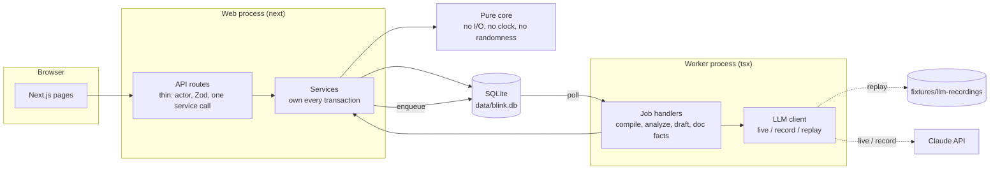

# Blink

Created in [T3 Code](https://t3.codes).

Blink sits with a banker during an expert call. It warns them when the conversation reaches inside information, hides what was flagged as soon as the call ends, and gives compliance the evidence for every decision.

- **Design:** [docs/superpowers/specs/2026-11-10-live-guidance-design.md](docs/superpowers/specs/2026-11-10-live-guidance-design.md) (the live call, hiding, sign-in, observability). [BLINK_BUILD_SPEC.md](BLINK_BUILD_SPEC.md) is the original after-call build; where the two disagree, the design document wins.
- **Demo:** [docs/demo-script.md](docs/demo-script.md), five minutes around a live call.
- **State and open work:** [HANDOFF.md](HANDOFF.md).

> The demo data is synthetic: Halvorsen Pumps, Brightwater, the expert, the demo policy and the six documents are made up. `fixtures/real/` holds the test material, which is real: calls quoted in public court and Justice Department documents, and three published firm policies from EDGAR. Two more calls, from a UK regulator's notice, are kept off the repository; see `fixtures/real/README.md`.

## What it does

A banker at a fund talks to an industry expert. Compliance has to make sure the expert did not pass on confidential information before anything from the call is used. Blink does the listening, reading and bookkeeping, and people make the decisions.

**During the call.** The banker opens the Mac app, picks the case and presses Start. A pill at the top of the screen, above Zoom or any other call app, says one of five things:

| Pill | When |
|---|---|
| `Listening` | Most of the call |
| `Getting close to inside information. Steer away.` | The banker asks for something a rule restricts, or a statement is one fact short of a rule |
| `Sounds like inside information. Move on.` | What was said meets a rule that requires review |
| `Blink can't hear the call.` | A stage of the live path has been down for more than 3 seconds |
| `Call ended. N passages hidden and sent to compliance.` | The call is over (`Call ended. Nothing was hidden.` for none) |

The microphone is one channel, and the computer's audio (everyone else) is the other. Deepgram Flux transcribes both and marks the end of each turn. For each turn, `claude-haiku-5-5` fills in a fixed form, and the pure rules in `src/core/` decide the pill. No model decides a policy outcome.

**After the call.**

1. **The flagged passages are hidden at once.** The server returns a blank bar in their place to everyone but compliance.
2. **The after-call read runs.** `claude-opus-5-5` reads the whole transcript and extracts claims with exact quotes. Code checks every quote, applies the approved policy and compares each claim with public documents. This read can hide more than the live path did. Anything flagged live stays hidden until compliance decides it.
3. **Compliance decides.** A reviewer sees each hidden passage in full, with the rule trace, and keeps it hidden, unhides it, or sends it to legal. Escalated findings need a senior compliance officer.
4. **Release.** A summary is drafted only from statements compliance did not restrict, and approved by hash. Before release, code checks it against every hidden passage. The banker then reads the summary and the transcript, with the kept passages still blanked out.
5. **Staleness.** If the evidence changes afterwards, for example a corrected transcript, the decisions and approvals that depended on the changed part reopen.

Each call has a record that compliance can read: every turn with what was heard, read, checked and shown, how long each step took and what it cost. Every step goes into a hash-chained audit log.

The policy owner writes the policy in plain language. A model compiles it into rules and one state machine per rule. Code checks every combination of evidence and runs scenarios a reviewer wrote beforehand. The owner approves one exact hash.

## Deployed

**https://blink-production.up.railway.app** (Railway trial, until 2026-12-10).

- **Live:** models and speech-to-text are live (`BLINK_LLM_MODE=live`).
- **Sign-in:** password only, with no role switcher.
- **Data:** SQLite on a 0.5 GB volume at `/data`, so data survives a restart or a redeploy.
- **Check:** `pnpm smoke --url https://blink-production.up.railway.app`.

**Signing in.**

- **The four demo accounts:** sign in with a demo account's email and password. Emails are the first name at `blink.demo`: `priya@`, `marcus@`, `jordan@` and `dana@`.
- **Passwords:** not in the repository. The owner keeps them in `.env.local` as `BLINK_SEED_PASSWORDS`, and the same value is in the Railway service's variables.
- **New accounts:** anyone can choose "Create an account" on the sign-in page. A new account is always a banker, who sees only their own cases.

**The app.**

- **The landing page** shows the Blink mark on a moving dither field. Clicking it opens the app.
- **The header** holds the section links and the "Walk me through a trial" button. The button gives a guided tour: it highlights the next control and lists each step of a run.
- **The banker** sees Call, Cases and Released briefs. Call starts a call from one button and shows a plain line for what Blink did on each turn, never what was said. The floating pill needs the Mac app.

## Quickstart

Needs Node 26 (`.nvmrc`) and pnpm. It is also tested on Node 24.10; `better-sqlite3` needs 22 or newer.

```bash
pnpm i
pnpm db:reset      # creates data/blink.db, seeds users, documents and one case
pnpm dev           # web on http://localhost:3000, plus the worker
```

No API key is needed. With `BLINK_LLM_MODE` unset, the after-call path runs in replay mode and serves model responses from `fixtures/llm-recordings/`. A live call always needs both keys, because audio cannot be replayed. Use the scripted call (below) to try it without them.

### Two sign-in modes

- **Role switcher** (`BLINK_AUTH_MODE=switcher`). `pnpm dev`, `pnpm demo` and the browser tests use it. There is no password: the menu in the header acts as one of the four seeded users. A production build (`next start`) uses it only with `BLINK_ALLOW_SWITCHER=1` as well.
- **Password**, everywhere else, including the deployment. A production server is in password mode unless both of the above are set.
  - **Seeded users:** they get their passwords from `BLINK_SEED_PASSWORDS`, JSON keyed by user id, when the database is seeded. A password already set is never replaced.
  - **To try it locally:**

    ```bash
    pnpm build
    BLINK_DB_PATH=./data/prod-check.db NODE_ENV=production BLINK_AUTH_MODE=password BLINK_LLM_MODE=replay PORT=3200 sh scripts/start-prod.sh
    ```

    The seed reads `BLINK_SEED_PASSWORDS` from `.env.local`.

| User | Role | Does |
|---|---|---|
| Priya Raman | Banker (`analyst` in the code) | Opens cases, runs calls, reads released briefs and transcripts |
| Marcus Lee | Compliance reviewer | Reviews findings, attests, approves and releases briefs |
| Jordan Ellis | Senior compliance officer | Decides escalated findings, and everything a reviewer does |
| Dana Okafor | Policy owner | Compiles and approves policy |

The server checks the role, and the case, on every request. A banker can open only their own cases, and never a hidden passage.

## The Mac app

The banker's app is a small Electron shell in `desktop/`. It floats the pill and hands the web app the system audio. It needs macOS 14.2 or later on Apple silicon.

```bash
pnpm desktop:build   # package desktop/out/Blink-darwin-arm64/Blink.app and sign it ad hoc
pnpm desktop:smoke   # run the packaged app with --smoke and check its windows
open -n desktop/out/Blink-darwin-arm64/Blink.app --args --server=https://blink-production.up.railway.app
```

- **Server:** without `--server`, it uses `http://localhost:3000`.
- **Open it packaged, with `open`:** never run it with `electron .` or by running the binary inside the app. macOS grants the system-audio permission to the app that opened it, and the wrong one gets a silently dead audio track.
- **Permissions:** allow Microphone and System Audio Recording when macOS asks. Each rebuild asks again.
- **The banker wears headphones,** so the other side reaches Blink only through the system audio and never through the microphone.
- **Not yet tested on a real call.** It was built assuming macOS needs a screen source for system audio (`audio grant: needs-video`). The spike that settles that is waiting on the owner; see HANDOFF.
- **`desktop/README.md`** has the details.

**A live call on this machine:**

1. Run `pnpm live:prepare`. It resets `data/blink.db` to the Halvorsen case at intake with the demo policy active.
2. Start the server: `BLINK_LLM_MODE=live BLINK_AUTH_MODE=switcher pnpm dev`. It needs `ANTHROPIC_API_KEY` and `DEEPGRAM_API_KEY` in `.env.local`.
3. Open the Mac app.

**A scripted call, no keys:** run `pnpm live:prepare`, then `BLINK_ALLOW_SCRIPTED_CALLS=1 pnpm dev` in replay mode. Open http://localhost:3000/desktop/pill in one tab and http://localhost:3000/desktop?source=script in another, as Priya. Start plays the Halvorsen call from recorded reads, with no microphone.

## Running the demo

The finals demo is a live call on the deployment: [docs/demo-script.md](docs/demo-script.md).

The original after-call demo still runs offline, from recordings:

```bash
pnpm db:reset
pnpm demo          # production build, replay mode, switcher sign-in, no network calls
```

Then follow the ten steps in [section 19 of the build spec](BLINK_BUILD_SPEC.md#19-demo-script-for-the-finals). In short:

1. **Policy owner:** Policy → New policy version → "Broken variant" → compile. It ends `COMPILE_FAILED`, and Approve is disabled.
2. **Policy owner:** New policy version → "Demo policy v1" → compile → `VALIDATED`. Look at the tabs, then approve by typing the first six characters of the hash → `ACTIVE`.
3. **Banker:** open the case → "Fixture: transcript v1" → Upload and analyze.
4. **Reviewer:** open the case. F1 links turns T5 and T11. Answer the question on F3, dispose F2, and try to dispose F1.
5. **Senior compliance officer:** dispose F1. **Reviewer:** dismiss the AI suggestions, then Attest.
6. **Reviewer:** Brief → Draft with AI → approve → release. **Banker:** Released briefs.
7. **Reviewer:** upload "Fixture: transcript v2". The approval and the attestation go stale, and release is blocked with the reasons listed. Re-attest, redraft, approve, release.
8. Audit → Verify chain. Then Metrics.

`pnpm demo:check` runs the same flow through the services in a scratch database and checks each step against the gold labels. `pnpm e2e` runs it through the browser.

### Proving it needs no network

```bash
pnpm demo:offline
```

This runs `pnpm db:reset` and `pnpm demo` inside a macOS sandbox that denies every network connection except loopback. It then drives all ten steps through a browser against that server and verifies the audit chain.

- **The sandbox is checked first:** the script requests three outside addresses, one of them a raw IP, and stops if any of them answers.
- **The pages are checked too:** the browser test fails if a page requests anything from a host other than the app.
- **Why a sandbox:** it is used instead of switching Wi-Fi off, so the rest of the machine stays online.
- **It resets `data/blink.db`,** as the demo runbook does.
- **On other systems:** turn the network off and run `pnpm db:reset && pnpm demo`, then `BLINK_E2E_BASE_URL=http://localhost:3000 pnpm e2e` in a second terminal.

The AI brief draft is replayed from a recording made for one exact set of decisions (the ones above). If you decide the findings differently, the draft has no recording and says so. "Template draft" produces a brief with no model.

## What is real and what is recorded

| Part | Status |
|---|---|
| The live path: audio, Flux, the live reader, the pill | **Always live.** Audio cannot be replayed. The scripted call replays recorded reads for tests. |
| Policy validation, exhaustive enumeration, scenario runs, preview | Real. Deterministic code, runs every time. |
| Quote validation, public-evidence comparison, predicate and monitor evaluation | Real. Deterministic code. |
| Finding, case, brief, and policy workflows; role and case checks; blanking; the release and leak checks | Real. Enforced on the server. |
| Dependencies, staleness, the audit hash chain | Real. |
| Policy compilation, claim extraction, document facts, brief drafts | Live on the deployment. Locally, **recorded** by default: real output of `claude-opus-5-5`, captured once and replayed. The UI marks it "Replayed from recorded run". |

In replay mode a request with no recording fails with the stage and hash named. It never falls back to the network.

The recordings were made with the prompts in `src/server/llm/prompts/`. A request is found by a hash of its prompt, so changing a prompt means recording again. `tests/services/recordings.test.ts` fails if the two drift apart.

### Recording with a live model

```bash
cp .env.example .env.local     # set ANTHROPIC_API_KEY; BLINK_LLM_MODE=record
pnpm record                    # the whole demo flow, checked against gold labels
pnpm record:live               # the scripted live call's reads
pnpm eval                      # extraction on Halvorsen and the eight edge cases
```

Record mode calls the API only for requests that have no recording yet, so an interrupted run resumes without paying twice. Set `BLINK_LLM_RERECORD=1` to refresh everything. Set `BLINK_LLM_MODE=live` to call the API without recording.

## Architecture



**The live path** runs beside it.

1. The Mac app loads two pages from the same server: the control page (`/desktop`) and the pill (`/desktop/pill`).
2. The control page streams the two channels to Flux with a short-lived token from the server.
3. It posts each finished turn to `/api/calls/:id/turns`.
4. The live reader fills in the form, the rules decide, and the reply carries the pill.
5. Ending the call turns the turns into transcript v1 and starts the after-call read.

Four rules shape the code:

- **The model proposes; code decides.** Model output is data. It is validated against a schema, then checked again by deterministic code (quotes, guards, citations). It never changes state by itself.
- **The core is pure.** `src/core/` has no I/O, no clock, and no randomness, so the policy validator, the reducer, the comparator, the pill decision, the blanking and the workflows are plain functions with unit tests.
- **Services own transactions.** Every mutation is one SQLite transaction that also writes the audit event. Routes do not contain logic.
- **Inputs are pinned.** A decision, an attestation, and an approval each record the hashes of what they were based on. Staleness is a comparison of those hashes with the current ones.

Evidence has four states (supported, refuted, unknown, conflict). A rule's guard is evaluated in three-valued logic, so missing evidence makes a rule indeterminate instead of quietly false, and a conflict always opens review.

## Commands

| Command | What it does |
|---|---|
| `pnpm dev` | Web and worker, with reload, switcher sign-in |
| `pnpm demo` | Production build and start, replay mode, switcher sign-in |
| `pnpm db:reset` | Recreate and seed `data/blink.db`, then replay the eval so Metrics has a result |
| `pnpm db:reset:dev` | As above, and also activate the hand-written fallback policy and load hand-labeled claims: a case ready to review with no model involved |
| `pnpm live:prepare` | Reset `data/blink.db` for a real local call: the Halvorsen case at intake, the demo policy active |
| `pnpm test` | Unit and service tests, including the break-in tests; no network |
| `pnpm e2e` | In a browser against production builds: the offline demo, then the scripted live call, the call record and the pill |
| `pnpm demo:check` | The demo flow through the services, checked against gold labels, from recordings |
| `pnpm live:check` | The scripted live call through the services, from recorded reads: the pill goes red at the source remark |
| `pnpm demo:offline` | `pnpm db:reset` and `pnpm demo` with the network denied by a sandbox, then the demo flow in a browser (macOS) |
| `pnpm record` / `pnpm record:live` | The demo flow, or the scripted call, in record mode (calls the API for anything not yet recorded) |
| `pnpm eval` | Score extraction against gold labels on the nine synthetic fixtures |
| `pnpm eval:policies` | Compile the three real policies (`BLINK_LLM_MODE=replay` serves the recordings) |
| `BLINK_LLM_MODE=live pnpm eval:real` | Run the after-call pipeline on the real development set and count per call and per policy (paid) |
| `pnpm eval:spoken` | Read a written call aloud with synthetic voices and run it through the live path (paid; needs `say` and `ffmpeg`) |
| `pnpm smoke --url <address>` | Check a deployment: health, sign-in for all four users, and the banker's refusals |
| `pnpm desktop:build` / `pnpm desktop:smoke` | Package the Mac app; check the packaged app's windows |
| `pnpm audit:verify` | Recompute the audit hash chain |
| `pnpm typecheck` / `pnpm lint` | TypeScript and ESLint |

## Layout

```text
desktop/           the banker's Mac app (Electron)
docs/              the demo script, the eval reports, the design and the plan
fixtures/          synthetic policy, case, edge cases and documents; real/ test material; the LLM recordings
scripts/           seed, worker, evals, record-demo, record-live, speak-call, smoke, start-prod
src/core/          pure domain logic: logic, predicates, policy, runtime, workflow, evidence, deps, live, release
src/server/        database, auth, audit log, LLM client and prompts, live reader, jobs, services, eval
src/app/           pages and API routes
src/components/    UI
tests/             core, services, e2e, e2e-live
```

## Results

Measured on 2026-11-10, each on a small sample, and reported as counts:

- [docs/eval/2026-11-real-policies.md](docs/eval/2026-11-real-policies.md): three published policies compiled by Blink. All three compile; none validates.
- [docs/eval/2026-11-real-dev.md](docs/eval/2026-11-real-dev.md): the after-call read on five real calls. All five labelled statements were hidden under every policy.
- [docs/eval/2026-11-spoken.md](docs/eval/2026-11-spoken.md): six calls through the live path as speech. None of the 6 labelled turns went red live, and all 6 were hidden after the call.
- [docs/eval/2026-11-deployed-run.md](docs/eval/2026-11-deployed-run.md): one full live run on the deployment.

## Limits

Blink never says a call "is compliant" or that information "is MNPI". It says which policy conditions evaluated to what, on which evidence, and what a person decided.

- **A handful of real test calls.** Five development calls with five labelled statements; two of the calls are private. The sealed set has not been run yet.
- **No stay-quiet set,** so the false-alarm rate is unmeasured. The request for permission to use In Practise's interviews has not been sent.
- **Synthetic voices** read the calls in the spoken test (macOS `say`, no room noise). Real calls will transcribe worse.
- **Live reds can be missed.** The live path misses its speed target. On the deployed run, a typical turn was shown 1.8 s after Flux's audio window ended, and 19 in 20 within 2.8 s. The target is 1.0 s and 2.0 s, and the window itself ends about 0.8 s after the words do. An expert turn that carries a claim often runs past the reader's 2.5 s limit and is not read live. The after-call read still hides it.
- **Flux can mishear an issuer's name.** It wrote Halvorsen as "Halvason", and an issuer-specific rule then stayed quiet until a reviewer corrected the company.
- **Real policies compile with coverage gaps.** The ten predicates cannot express some required clauses, so none of the three real policies validates.
- **The Mac app is unproven on a real call** (see above). The Chrome fallback is not built.
- **Synthetic Metrics.** The numbers on the Metrics page come from nine synthetic fixtures. They show that the measurement works, not production accuracy.
- **"Not found in public documents"** means not found in the six curated documents. It never means the information is proven nonpublic.
- **One server.** It runs as one container with a SQLite file and one worker, with no single sign-on and no expert-network integration.
