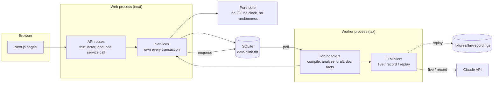

# Blink

Created in [T3 Code](https://t3.codes).

Blink helps compliance teams review expert calls faster, with evidence behind every flagged concern.

**Build spec:** see [BLINK_BUILD_SPEC.md](BLINK_BUILD_SPEC.md) for the full architecture, research, fixtures, and phased build plan.

> All data in this repository is synthetic. Halvorsen Pumps, Brightwater, the expert, the policy, and every document are made up. The app shows a "Synthetic data" pill on every screen.

## What it does

A fund's analyst talks to an industry expert. Before anything from that call is used, compliance has to check that the expert did not pass on confidential information. Blink does the reading and the bookkeeping; people make the decisions.

1. The policy owner pastes the firm's policy in plain language. A model drafts rules and one small state machine ("monitor") per rule. Code then checks the result: it enumerates every combination of evidence, runs scenarios a reviewer wrote beforehand, and blocks anything that fails. The owner approves one exact hash, and only then is the policy used.
2. An analyst uploads a call transcript. A model extracts what the expert claimed, with exact quotes. Code checks every quote character for character against the transcript and drops what it cannot find.
3. Code evaluates each claim against the approved policy and compares it with a curated set of public documents. The model is not involved in either step.
4. A reviewer sees the findings with the linked passages, the rule trace, and the public comparison, and decides each one. Escalated findings need a senior compliance officer.
5. A brief is drafted only from statements compliance did not restrict. It is approved by hash and released after a server-side check.
6. If the evidence changes afterwards, for example a corrected transcript, exactly the decisions and approvals that depended on the changed part reopen.

Every step is written to a hash-chained audit log.

## Quickstart

Needs Node 26, the version the spec pins (`.nvmrc` has it), and pnpm. Tested on Node 26.13 and 24.10; `better-sqlite3` needs 22 or newer.

```bash
pnpm i
pnpm db:reset      # creates data/blink.db, seeds users, documents, and one case
pnpm dev           # web on http://localhost:3000, plus the worker
```

No API key is needed. With `BLINK_LLM_MODE` unset the app runs in replay mode and serves model responses from `fixtures/llm-recordings/`.

There is no login. Use the menu in the header to act as one of four seeded users:

| User | Role | Does |
|---|---|---|
| Priya Raman | Analyst | Opens cases, uploads transcripts, reads released briefs |
| Marcus Lee | Compliance reviewer | Reviews findings, attests, approves and releases briefs |
| Jordan Ellis | Senior compliance officer | Decides escalated findings |
| Dana Okafor | Policy owner | Compiles and approves policy |

The server checks the role on every request. Switching user changes a cookie, nothing else.

## Running the demo offline

```bash
pnpm db:reset
pnpm demo          # production build, replay mode, no network calls
```

Then follow the ten steps in [section 19 of the spec](BLINK_BUILD_SPEC.md#19-demo-script-for-the-finals). In short:

1. **Policy owner:** Policy → New policy version → "Broken variant" → compile. It ends `COMPILE_FAILED` and Approve is disabled.
2. **Policy owner:** New policy version → "Demo policy v1" → compile → `VALIDATED`. Look at the tabs, then approve by typing the first six characters of the hash → `ACTIVE`.
3. **Analyst:** open the case → "Fixture: transcript v1" → Upload and analyze.
4. **Reviewer:** open the case. F1 links turns T5 and T11. Answer the question on F3, dispose F2, and try to dispose F1.
5. **Senior compliance officer:** dispose F1. **Reviewer:** dismiss the AI suggestions, then Attest.
6. **Reviewer:** Brief → Draft with AI → approve → release. **Analyst:** Released briefs.
7. **Reviewer:** upload "Fixture: transcript v2". The approval and the attestation go stale; release is blocked with the reasons listed. Re-attest, redraft, approve, release.
8. Audit → Verify chain. Then Metrics.

`pnpm demo:check` runs the same flow through the services in a scratch database and checks each step against the gold labels. `pnpm e2e` runs it through the browser.

### Proving it needs no network

```bash
pnpm demo:offline
```

This runs `pnpm db:reset` and `pnpm demo` inside a macOS sandbox that denies every network connection except loopback, then drives all ten steps through a browser against that server and verifies the audit chain. It first requests three outside addresses, one of them a raw IP, and stops if any of them answers. The browser test also fails if a page requests anything from a host other than the app.

It uses a sandbox instead of switching Wi-Fi off, so the rest of the machine stays online. It resets `data/blink.db`, as the demo runbook does. On other systems, turn the network off and run `pnpm db:reset && pnpm demo`, then `BLINK_E2E_BASE_URL=http://localhost:3000 pnpm e2e` in a second terminal.

The AI brief draft is replayed from a recording made for one exact set of decisions (the ones above). If you decide the findings differently, the draft has no recording and says so; "Template draft" produces a brief with no model.

## What is real and what is recorded

| Part | Status |
|---|---|
| Policy validation, exhaustive enumeration, scenario runs, preview | Real. Deterministic code, runs every time. |
| Quote validation, public-evidence comparison, predicate and monitor evaluation | Real. Deterministic code. |
| Finding, case, brief, and policy workflows; role checks; release check | Real. Enforced on the server. |
| Dependencies, staleness, the audit hash chain | Real. |
| Review timing and the other metrics | Real measurements of what you do in the app. |
| Policy compilation, claim extraction, document facts, brief drafts | **Recorded.** Real output of `claude-opus-5-5`, captured once and replayed. The UI marks it "Replayed from recorded run". |
| Companies, people, policy, transcript, documents | **Synthetic.** Written for this demo. |

In replay mode a request with no recording fails with the stage and hash named. It never falls back to the network.

The recordings were made with the prompts in `src/server/llm/prompts/`. A request is found by a hash of its prompt, so changing a prompt means recording again. `tests/services/recordings.test.ts` fails if the two drift apart.

### Recording with a live model

```bash
cp .env.example .env.local     # set ANTHROPIC_API_KEY; BLINK_LLM_MODE=record
pnpm record                    # the whole demo flow, checked against gold labels
pnpm eval                      # extraction on Halvorsen and the eight edge cases
```

Record mode calls the API only for requests that have no recording yet, so an interrupted run resumes without paying twice. Set `BLINK_LLM_RERECORD=1` to refresh everything. The 27 committed recordings cost about $1.50 in total at list price: about $1.20 for the demo flow and the rest for the eight edge cases. Set `BLINK_LLM_MODE=live` to call the API without recording.

## Architecture



Four rules shape the code:

- **The model proposes; code decides.** Model output is data. It is validated against a schema, then checked again by deterministic code (quotes, guards, citations). It never changes state by itself.
- **The core is pure.** `src/core/` has no I/O, no clock, and no randomness, so the policy validator, the reducer, the comparator, and the workflows are plain functions with unit tests.
- **Services own transactions.** Every mutation is one SQLite transaction that also writes the audit event. Routes do not contain logic.
- **Inputs are pinned.** A decision, an attestation, and an approval each record the hashes of what they were based on. Staleness is a comparison of those hashes with the current ones.

Evidence has four states (supported, refuted, unknown, conflict). A rule's guard is evaluated in three-valued logic, so missing evidence makes a rule indeterminate instead of quietly false, and a conflict always opens review.

## Commands

| Command | What it does |
|---|---|
| `pnpm dev` | Web and worker, with reload |
| `pnpm demo` | Production build and start, replay mode |
| `pnpm db:reset` | Recreate and seed `data/blink.db`, then replay the eval so Metrics has a result |
| `pnpm db:reset:dev` | As above, and also activate the hand-written fallback policy and load hand-labeled claims: a case ready to review with no model involved |
| `pnpm test` | 353 unit and service tests, no network |
| `pnpm e2e` | The demo flow in a browser against a production build |
| `pnpm demo:check` | The demo flow through the services, checked against gold labels, from recordings |
| `pnpm demo:offline` | `pnpm db:reset` and `pnpm demo` with the network denied by a sandbox, then the demo flow in a browser (macOS) |
| `pnpm record` | The same flow in record mode (calls the API for anything not yet recorded) |
| `pnpm eval` | Score extraction against gold labels on nine fixtures |
| `pnpm audit:verify` | Recompute the audit hash chain |
| `pnpm typecheck` / `pnpm lint` | TypeScript and ESLint |

## Layout

```text
fixtures/          synthetic policy, case, edge cases, documents, and the LLM recordings
scripts/           seed, worker, eval, record-demo, verify-audit
src/core/          pure domain logic: logic, predicates, policy, runtime, workflow, evidence, deps
src/server/        database, auth, audit log, LLM client and prompts, jobs, services, eval
src/app/           pages and API routes
src/components/    UI
tests/             core, services, e2e
```

## Limits

Blink never says a call "is compliant" or that information "is MNPI". It says which policy conditions evaluated to what, on which evidence, and what a person decided.

- The numbers on the Metrics page come from nine synthetic fixtures. They show that the measurement works. They are not production accuracy.
- "Not found in public documents" means not found in the six curated documents. It never means the information is proven nonpublic.
- The policy vocabulary is ten predicates. A clause it cannot express is listed as "not automated" for a reviewer to apply by hand.
- Authentication is a cookie naming a seeded user. Role checks are real; identity is not.
- It runs on one machine with a SQLite file and one worker. There is no deployment, SSO, live audio, or expert-network integration.
